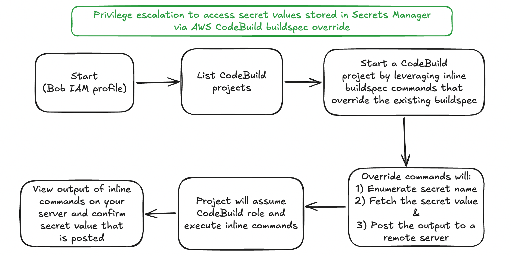

# Scenario: codebuild_buildspec_override

**Size:** Small

**Difficulty:** Medium

**Command:** `$ ./cloudgoat.py create codebuild_buildspec_override`

## Scenario Resources

- 1 IAM User (Bob, the low-privileged starting identity)
- 1 IAM Role (CodeBuild service role, the privileged identity assumed by the build)
- 2 IAM Policies (one attached to IAM user Bob, one attached to the service role)
- 1 CodeBuild Project (no reference to the target secret anywhere in its configuration)
- 1 Secrets Manager Secret

## Scenario Start(s)

1. IAM User "Bob", access key and secret key provided in `start.txt`

## Scenario Goal(s)

Retrieve the value of the secret stored in AWS Secrets Manager.

## Summary

Starting as the low-privileged IAM user Bob, the attacker discovers they have just enough permissions to list, inspect, and start CodeBuild projects. The existing CodeBuild project runs under a service role with `secretsmanager:ListSecrets` and `secretsmanager:GetSecretValue` scoped to the one target secret, permissions Bob himself lacks. Inspecting the project's configuration discloses only its service role ARN, there is no environment variable or other reference pointing at the target secret anywhere in the project.

By starting a new build and overriding the buildspec with inline commands, the attacker hijacks the build execution context. The injected commands run as the CodeBuild service role, call `secretsmanager:ListSecrets` to enumerate the secrets in the account, then loop `secretsmanager:GetSecretValue` over the results. The fetched value is exfiltrated by POSTing it to an attacker-controlled HTTP listener, completing the privilege escalation, without the attacker ever needing to learn the secret's name in advance.

## Exploitation Route(s)

## Walkthrough - Bob

1. As the IAM user Bob, the attacker begins by enumerating available permissions. Direct calls to Secrets Manager or IAM are denied.

2. The attacker lists CodeBuild projects using `codebuild:ListProjects` and discovers a project named `cg-vulnerable-project-<cgid>`.

3. Using `codebuild:BatchGetProjects`, the attacker inspects the project's configuration and learns its service role ARN. No secret reference is disclosed here, the project's configuration contains nothing pointing at Secrets Manager. The attacker cannot assume the role or read any secret directly, but can trigger the role's permissions indirectly by starting a build.

4. The attacker starts a new build on the discovered project using `codebuild:StartBuild`. Crucially, they supply a `buildspecOverride` parameter containing an inline buildspec with attacker-controlled shell commands.

5. The injected buildspec calls `secretsmanager:ListSecrets` using the build's inherited role credentials, which returns the secrets in the account, then loops `secretsmanager:GetSecretValue` over the results and POSTs each fetched value to an attacker-controlled HTTP listener (e.g. `webhook.site`).

6. The CodeBuild project assumes its service role for the duration of the build. Because the service role has `secretsmanager:ListSecrets` and `secretsmanager:GetSecretValue` scoped to the target secret, the injected loop succeeds in both enumerating and reading it.
Note: GetSecretValue fails for any other secret name returned by the enumeration. This is intentional, it keeps the scenario's attack surface limited to the one target secret.

7. The attacker observes the secret value arrive at their listener, completing the scenario.

A cheat sheet for this route is available [here](./cheat_sheet.md).
